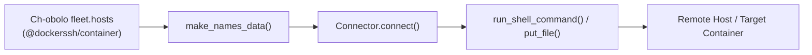

Ch-aOS executes roles across remote systems using Pyinfra's connection engine. In addition to standard SSH (`@ssh/`), Ch-aOS supports specialized connection drivers called **Connectors** (such as `@dockerssh/`, `@chroot/`, `@vagrant/`, `@terraform/`, `@local`).

This guide details how Pyinfra connectors function and how you can develop custom connectors for unique transport protocols or container engines.

---

## Connector Architecture

A Connector consists of three fundamental components:

1. **`ConnectorData`**: A `TypedDict` defining all connection parameters that can be passed in `fleet.hosts` (e.g. `ssh_hostname`, `ssh_port`, `ssh_user`, `ssh_key`).
2. **`DataMeta`**: Parameter documentation and default values for each connection key.
3. **`BaseConnector`**: The execution class handling connection lifecycle (`connect`, `disconnect`), remote command execution (`run_shell_command`), file transfers (`put_file`, `get_file`), and rsync (`rsync`).



---

## Defining `ConnectorData` and `DataMeta`

```python
from typing import Any, TypedDict
from pyinfra.connectors.base import DataMeta


class ConnectorData(TypedDict):
    ssh_hostname: str
    ssh_port: int
    ssh_user: str
    ssh_password: str
    ssh_key: str
    ssh_key_password: str
    ssh_allow_agent: bool
    ssh_connect_retries: int


connector_data_meta: dict[str, DataMeta] = {
    "ssh_hostname": DataMeta("Target remote hostname or IP"),
    "ssh_port": DataMeta("Remote SSH port", default=22),
    "ssh_user": DataMeta("Remote login user", default="root"),
    "ssh_password": DataMeta("SSH login password"),
    "ssh_key": DataMeta("Path to private key file"),
    "ssh_key_password": DataMeta("Passphrase for private key"),
    "ssh_allow_agent": DataMeta("Whether to authenticate with active SSH agent", default=True),
    "ssh_connect_retries": DataMeta("Number of connection retries", default=3),
}
```

This maps directly into your Ch-obolo `fleet:` definition:

```yaml
# ch-obolo.yml
fleet:
  hosts:
    "@ssh/prod-web-01":
      ssh_hostname: "192.168.1.50"
      ssh_user: "deployer"
      ssh_port: 22
      ssh_key: "~/.ssh/id_ed25519"
```

---

## The `BaseConnector` Implementation

```python
import abc
from typing import IO, Iterator, Optional, Type, Union
from pyinfra.api.command import StringCommand
from pyinfra.api.connectors import ConnectorArguments
from pyinfra.api.host import Host
from pyinfra.api.state import State
from pyinfra.connectors.base import BaseConnector, CommandOutput
from pyinfra.connectors.util import extract_control_commands, make_unix_command_for_host


class MyCustomConnector(BaseConnector):
    state: State
    host: Host

    handles_execution = True
    data_cls: Type = ConnectorData
    data_meta = connector_data_meta

    @staticmethod
    @abc.abstractmethod
    def make_names_data(name: str) -> Iterator[tuple[str, dict, list[str]]]:
        """Generate inventory targets.

        Yields (host_name, data_dict, group_names) tuples.
        """
        yield f"@custom/{name}", {"custom_target": name}, []

    def connect(self) -> None:
        """Establish connection. Raises ConnectError on failure."""
        pass

    def disconnect(self) -> None:
        """Tear down connection."""
        pass

    def run_shell_command(
        self,
        command: StringCommand,
        print_output: bool = False,
        print_input: bool = False,
        **arguments: ConnectorArguments,
    ) -> tuple[bool, CommandOutput]:
        """Execute a shell command on the target."""
        control_commands = extract_control_commands(arguments)
        wrapped_command = make_unix_command_for_host(
            self.state,
            self.host,
            command,
            **arguments,
        )

        timeout = control_commands.get("_timeout")
        success_exit_codes = control_commands.get("_success_exit_codes", [0])

        exit_code, output = self._execute(wrapped_command, timeout=timeout)
        success = exit_code in success_exit_codes
        return success, output

    def put_file(
        self,
        filename_or_io: Union[str, IO],
        remote_filename: str,
        remote_temp_filename: Optional[str] = None,
        print_output: bool = False,
        print_input: bool = False,
        **arguments: ConnectorArguments,
    ) -> bool:
        """Upload a file to the remote target."""
        return True

    def get_file(
        self,
        remote_filename: str,
        filename_or_io: Union[str, IO],
        remote_temp_filename: Optional[str] = None,
        print_output: bool = False,
        print_input: bool = False,
        **arguments: ConnectorArguments,
    ) -> bool:
        """Download a file from the remote target."""
        return True
```

---

## Best Practices & Technical Guidelines

1. **Handling Control Commands**: Always use Pyinfra's `make_unix_command_for_host()` and `extract_control_commands()` from `pyinfra.connectors.util`. This ensures global arguments like `_sudo`, `_doas`, `_sudo_user`, and `_env` are properly parsed and injected.
2. **Error Handling**: On connection failure, always raise `ConnectError` so Ch-aOS and Pyinfra can report clean diagnostic logs without unhandled traceback crashes.
3. **Stateless `make_names_data`**: Because `make_names_data` is a `@staticmethod`, avoid referencing instance state inside it.

---

## Connectors vs. Boats: Key Distinctions

- **[Boats](../advanced/boats.md)**: Provide **Dynamic Inventory Discovery** (e.g. querying AWS APIs or Proxmox clusters to find which machines exist).
- **Connectors**: Provide **Transport Connection Drivers** (e.g. SSH, Docker sockets, chroot jails, Kubernetes exec, serial consoles).

Boats and Connectors work together: a Boat can dynamically discover running containers and attach `@dockerssh/` or `@docker/` connector descriptors to them.